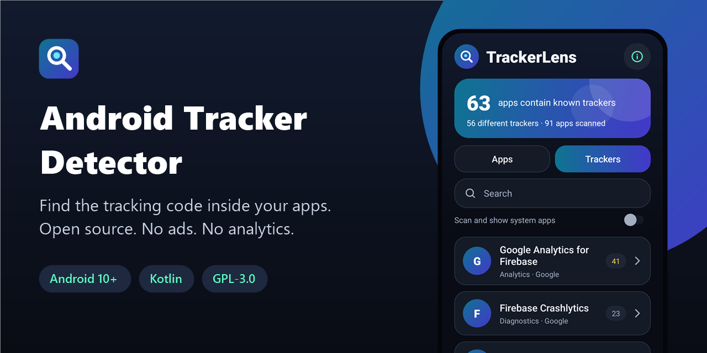
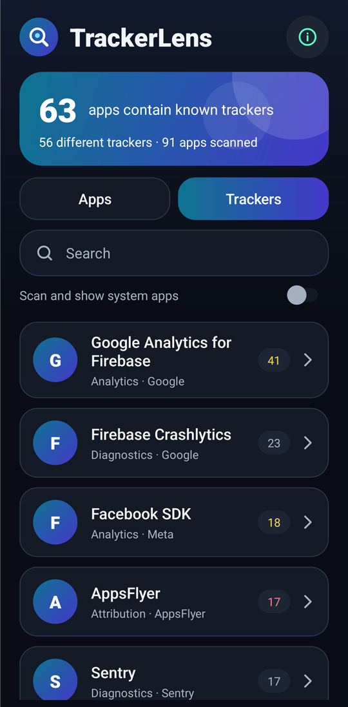
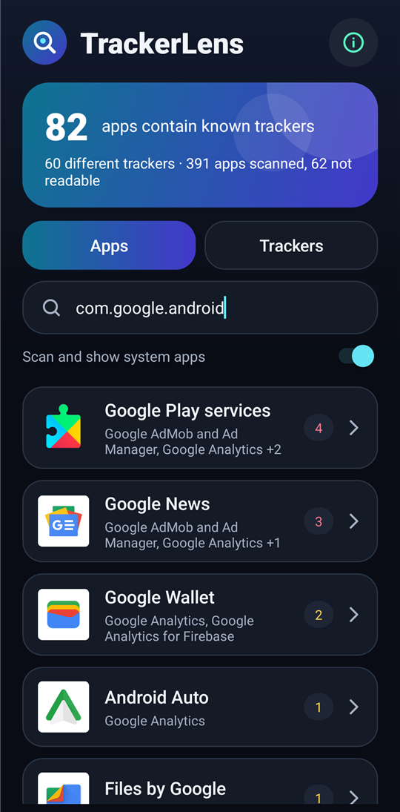
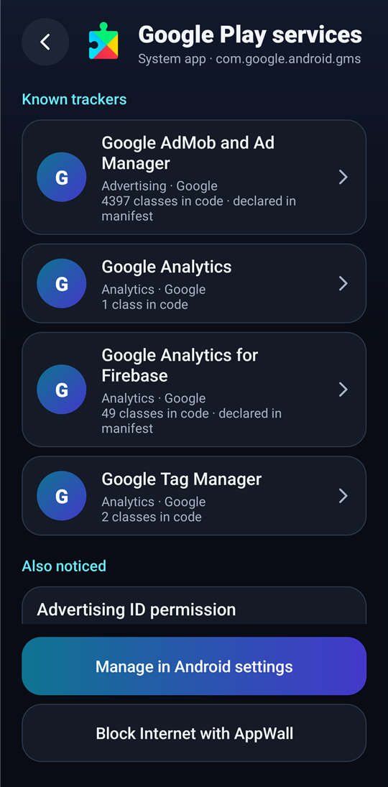
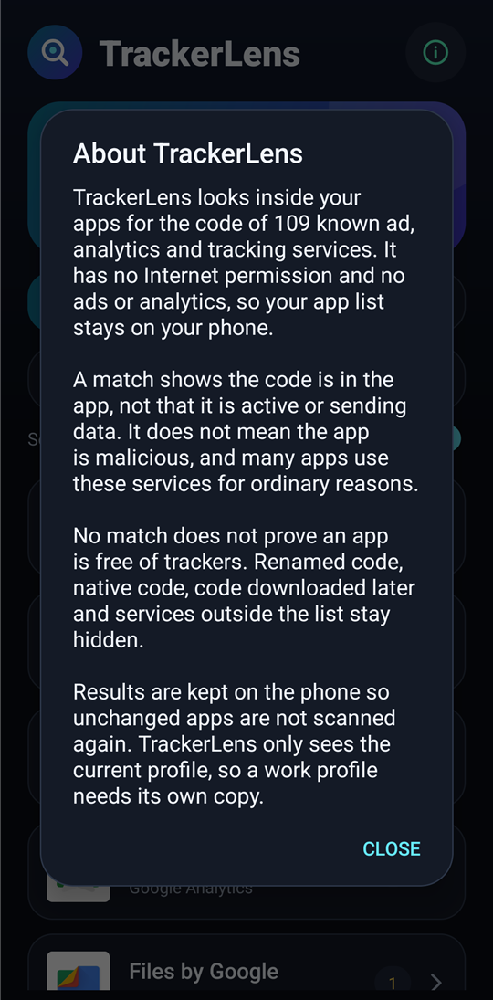

<div align="center">



# Android Tracker Detector

**Find the ad, analytics and tracking code inside your Android apps. Scans on your phone. Open source, no ads, no analytics.**

[](LICENSE)
[](#requirements)
[](https://kotlinlang.org)
[](app/build.gradle.kts)
[](app/src/main/AndroidManifest.xml)
[](https://github.com/Nekuzaky/android-tracker-detector/stargazers)

</div>

Android Tracker Detector ships an app called **TrackerLens**. It reads the code of the apps installed on your phone and lists the known ad, attribution, analytics, engagement, location and diagnostics services it finds.

TrackerLens has no Internet permission, so your list of apps and the results stay on your phone.

## Screenshots

<p align="center">
  
  
  
  
</p>

## Features

- **Apps:** every app ranked by the number of known trackers it contains
- **Trackers:** every tracker found, with the apps that contain it
- **Evidence:** the number of matching classes and whether the manifest declares the service
- **Coverage:** a clear message when the code of an app could not be read
- **Advertising ID:** shows the apps that declare the advertising ID permission
- **Search:** by app, package, tracker, owner or category
- **System apps:** an option to scan them too
- **AppWall link:** open [AppWall](https://github.com/Nekuzaky/android-app-firewall) to cut Internet access, when it is installed
- No ads, no analytics, no account and no third-party libraries

## How it works

1. TrackerLens asks Android for the installed apps and the paths of their APK files, which any app can read.
2. It reads the class names from every `classes*.dex` file, without loading or running any of that code.
3. It compares the package of each class with its list of known services. A match must stop at a package boundary, so `com.applovin` never matches `com.applovinish`.
4. It also checks the components and metadata the app declares in its manifest.
5. It stores the results privately, so an app is only scanned again after an update.

| Result | Meaning |
| --- | --- |
| **Known tracker** | Classes from this service are in the code of the app |
| **Declared only** | The manifest mentions the service, but no matching code was found. This is not counted as a tracker |
| **Code could not be read** | The app has no readable DEX file, which is common for preinstalled system apps |

The list covers advertising, attribution, analytics, engagement, location and diagnostics services. It is in [Catalog.kt](app/src/main/java/dev/nekuz/trackerlens/Catalog.kt), and corrections are welcome.

## What a result means

**A match shows the code is in the app, not that it is active or sending data.** An SDK can be turned off, used only after consent or pointed at a server the developer controls. A match does not mean an app is malicious, and many legitimate apps use these services.

**No match does not prove an app is free of trackers.** See [Limitations](#limitations).

## Privacy

- No Internet permission, so TrackerLens cannot send your data online.
- Results stay in the private storage of the app and are excluded from Android backups.
- The code of other apps is only read as data. It is never loaded or run.

### Permissions

| Permission | Why it is needed |
| --- | --- |
| `QUERY_ALL_PACKAGES` | Android hides most installed apps from other apps without it, and a scan needs the full list |

## Requirements

- Android 10 (API 29) or later
- JDK 21 and Android SDK 35 to build from source

Gradle 8.11 does not support the Java 25 runtime bundled with recent Android Studio versions, so use a separate JDK 21.

## Download

Download the signed APK from the [latest release](https://github.com/Nekuzaky/android-tracker-detector/releases/latest) and open it on your phone. Android may ask you to allow installs from the app you opened it with.

The release notes list the SHA-256 checksum of the APK and of its signing certificate.

## Build from source

A build signed with your own key cannot install over the release APK, so uninstall the app first.

```bash
git clone https://github.com/Nekuzaky/android-tracker-detector.git
```

```bash
cd android-tracker-detector
```

Create a `local.properties` file that points to your Android SDK:

```properties
sdk.dir=/path/to/Android/Sdk
```

Create a signing key, then add a `keystore.properties` file at the project root. It is ignored by Git, so never commit it or your key:

```properties
storeFile=/path/to/your-key.jks
storePassword=your-password
keyAlias=release
keyPassword=your-password
```

Build the release APK with JDK 21:

```bash
JAVA_HOME=/path/to/jdk-21 ./gradlew assembleRelease
```

Install it on a phone with USB debugging enabled. The `--user 0` option keeps it out of any work profile:

```bash
adb install -r --user 0 app/build/outputs/apk/release/app-release.apk
```

Run the unit tests:

```bash
JAVA_HOME=/path/to/jdk-21 ./gradlew testDebugUnitTest
```

## Limitations

- **Presence, not behavior.** TrackerLens does not watch network traffic and cannot tell whether a service is active.
- **Renamed code.** An SDK can stay hidden if its packages were renamed by a code shrinker, and the classes that remain can be very few.
- **Other hiding places.** Native code, encrypted or packed code, and code downloaded after install are not read.
- **The list is finite.** Services outside the catalog, and in-house trackers, are not detected, and the catalog needs updates over time.
- **Self-hosted services.** Some services, such as Sentry or Matomo, can run on the servers of the developer, so they do not always send data to a third party.
- **Preinstalled apps.** Many system apps have no readable code in their APK, so they appear as not readable.
- **One profile at a time.** TrackerLens only sees the current profile, so a work profile needs its own copy.
- **Not suited to the Play Store.** `QUERY_ALL_PACKAGES` is restricted, so the app is meant to be installed directly.

## Test status

Tested on one phone: Oppo Reno4 Z 5G, Android 12, ColorOS, using the signed release build.

| Check | Result |
| --- | --- |
| Unit tests | 28 pass |
| Class names read, compared with `dexdump` on 3 apps (75,619 classes) | No difference |
| Results compared with Exodus Privacy on 8 apps | Same or close, and app versions may differ. The gaps found were added to the list |
| Scan of 91 apps | Between 8 and 21 seconds |
| Scan including system apps | 391 apps, 62 not readable |
| App killed at 3 moments during a first scan | Same final results each time |
| Rotation during a scan, app removed while its details are open, app reinstalled | Pass |
| 16,000 random input events during and after a scan | No crash, no ANR |

Not tested: other brands, Android 10, 11, 13 and later, tablets, and work profiles. If something breaks on your phone, please open an issue.

## Related

- [Android App Firewall](https://github.com/Nekuzaky/android-app-firewall): cut Internet access per app.
- [Android Permission Manager](https://github.com/Nekuzaky/android-permission-manager): see what every app can access.
- [Android App Duplicator](https://github.com/Nekuzaky/android-app-duplicator): run a second account of an app in a work profile.

## License

Distributed under the [GNU General Public License v3.0](LICENSE).
